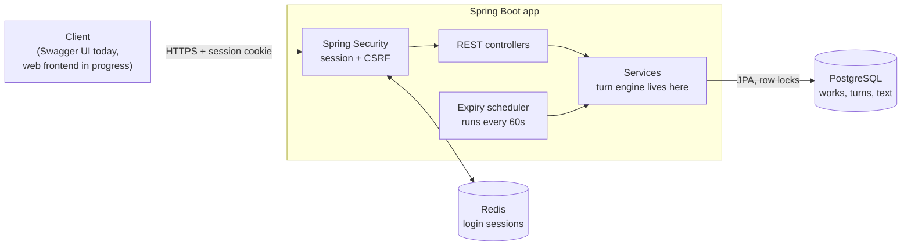
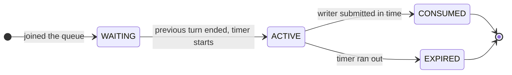
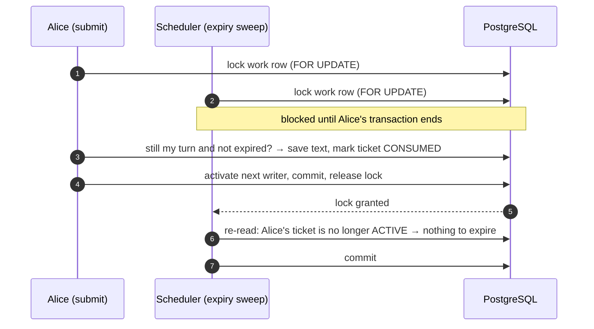

# Collective Unconscious

[](https://github.com/Ashx-xhsA/collective-unconscious/actions/workflows/ci.yml)


**A REST backend for turn-based collaborative writing.** A group writes one story together, one person at a time: the server decides whose turn it is, gives that person a timed writing slot, and moves on automatically if they don't show up.

**[▶ Try the live API (Swagger UI)](http://35.175.211.10:8080/swagger-ui/index.html)** · [API reference](API.md)

## How it works

### Architecture



The request path is the usual controller → service → repository layering. Two things are worth pointing out: Redis holds only login sessions, so the app servers stay stateless; and the scheduler calls the **same** service method as user requests, so a timeout and a submit use the same locking.

### A turn's life cycle

Each turn is a **ticket**. Tickets are never deleted. They only change status, so the full history of who wrote when is kept.



Whenever a turn ends, for either reason, the engine activates the next waiting ticket. In round-robin mode it also tops up the queue so that one full round is always lined up.

### What happens when two people act at once

Example: Alice's timer is about to run out, she presses submit, and at the same moment the scheduler tries to expire her turn.



If the scheduler had won the race instead, Alice's submit would see that her turn has expired and get a `409 Conflict`. Either way there is exactly one outcome, never two active writers and never a 500. The same lock also gives every ticket in a work a gap-free sequence number when many people join at once.

## Product rules

| Setting | Options |
|---|---|
| Work type | **Novel** (each turn adds a titled chapter) or **Article** (each turn adds an untitled paragraph) |
| Turn style | **Round-robin**: fixed order A→B→C→A…, new joiners go to the back · **Free-for-all**: anyone takes the next open turn |
| Timer | Each turn has a time limit set by the host; if it runs out, the turn passes to the next person |
| Limits | Optional cap on participants and on total rounds |
| Joining | Public, or restricted to people with an invitation code |

Planned: an *exquisite corpse* mode, where earlier text stays hidden until the work is finished (the data model already has the field).

## Tech stack

Java 25 · Spring Boot 4 (Web MVC, Data JPA, Security) · PostgreSQL + Flyway · Redis (Spring Session) · MapStruct · springdoc-openapi · JUnit 5 · GitHub Actions → Docker → AWS EC2

## Run it locally

Requirements: JDK 25 and Docker.

```bash
docker compose up -d db redis
```

```bash
./mvnw spring-boot:run
```

Then open <http://localhost:8080/swagger-ui/index.html>. Register, log in, create a work, and draw a ticket to take a turn.

To run the tests (they need a PostgreSQL database named `cu_test`; see [`application-test.properties`](src/test/resources/application-test.properties)):

```bash
./mvnw test
```

## Project layout

```
src/main/java/com/cu/collective_unconscious/
├── controller/    REST endpoints
├── services/      business logic, including the turn engine (TicketServiceImpl)
├── scheduling/    expiry sweep for timed-out turns
├── repository/    Spring Data JPA, including the row-locking queries
├── domain/        JPA entities and enums
├── dtos/ mappers/ request/response models and MapStruct mappers
├── security/      session-based auth
└── config/        security, scheduling, OpenAPI
src/main/resources/db/migration/   Flyway SQL migrations
```

## Status

The backend is complete and deployed. A web frontend is in progress.
