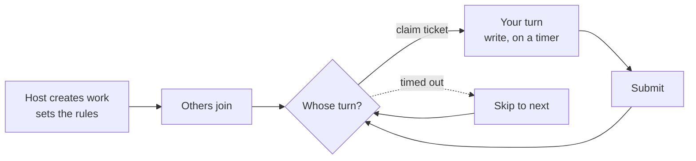

# Collective Unconscious

An asynchronous collaborative writing platform. A group takes turns writing one piece together, one person at a time.

Someone starts a story, the next person continues it, then the next until it's finished.

## Rules

- **Work type**: novel (each turn adds a titled chapter) or article (each turn adds an untitled paragraph).
- **Turn style**:
  - Round-robin — fixed order A→B→C→A…, new joiners go to the back, the system queues the next round automatically.
  - Free-for-all — anyone grabs the next open turn.
- **Timer**: every turn has a time limit; miss it and it's skipped, so a work never stalls on one person.
- **Joining**: public works are open to anyone; invitation-code works are limited to people who have the code.
- **Visibility**: default is fully readable; in *exquisite corpse* mode most of the earlier text stays hidden until the work is finished.

## Status

The backend is done. A **web frontend is in progress; aiming to launch soon.**

Live API docs (Swagger UI): _link coming soon_

Stack: Spring Boot 4 / Java 25 / PostgreSQL / Redis.
